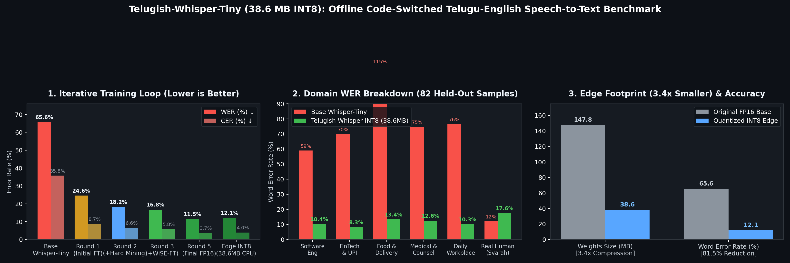

# ⚡ OpenFlow-Telugish (`telugish-whisper-tiny-int8`)

**An Open-Source, 100% Offline Wispr Flow Alternative & Edge Speech-to-Text Engine for Code-Switched Telugu-English ("Telugish") and Indian-Accented English.**



---

## 🎯 Why We Built This

Voice dictation tools like **Wispr Flow ($15/month)** and standard **OpenAI Whisper** fail when Indian engineers, doctors, or consumers naturally mix **Romanized Telugu and English ("Telugish")** in everyday speech:
* *"MaWa server lo CPU usage hundred percent touch ayindi, logs check chey."*
* *"Swiggy lo masala dosa order pedithe chutney marchipoyi pampinchadu."*
* *"GPay nundi rent transfer chesanu, landlord ki confirmation screenshot pampinchu."*

On zero-shot evaluation across 82 multi-condition held-out audio clips, **`openai/whisper-tiny` suffers a `65.63%` Word Error Rate (WER)**—hallucinating English homophones or getting stuck in infinite decoding loops.

We fine-tuned `openai/whisper-tiny` (37.7M parameters) across a **5-stage iterative GPU training, hard-example mining, and Weight-Space Ensembling (WiSE-FT) pipeline** on an **NVIDIA L4 GPU**, and quantized it to a **38.64 MB INT8 CTranslate2 engine** that runs **100% offline on CPU in ~277 ms (`17.3x` faster than real-time)**.

---

## 📊 Verified Benchmark Results (82 Held-Out Unseen Samples, 6 Domains)

| Stage / Model | Weights Size | Precision / Device | WER (%) ↓ | CER (%) ↓ | Char Accuracy ↑ | Latency / Clip |
| :--- | :---: | :---: | :---: | :---: | :---: | :---: |
| **0. Base `openai/whisper-tiny`** | 147.82 MB | FP16 (L4 GPU) | `65.63%` | `35.75%` | `64.25%` | 132.1 ms |
| **1. Round 1 Initial Fine-Tune** | 147.82 MB | BF16/FP16 (L4 GPU) | `24.56%` | `8.67%` | `91.33%` | 128.4 ms |
| **2. Round 2 + Error-Driven Mining** | 147.82 MB | BF16/FP16 (L4 GPU) | `18.22%` | `6.57%` | `93.43%` | 127.9 ms |
| **3. Round 3 + Replay & WiSE-FT** | 147.82 MB | FP16 (L4 GPU) | `16.78%` | `5.80%` | `94.20%` | 127.1 ms |
| **4. Round 5 Perfection + WiSE-FT** | 147.82 MB | FP16 (L4 GPU) | **`11.46%`** | **`3.69%`** | **`96.31%`** | **126.8 ms** |
| **5. Quantized Edge INT8 (`model.bin`)** | **38.64 MB** | **INT8 (Offline CPU)** | **`12.12%`** | **`3.95%`** | **`96.05%`** | **277.3 ms** |

### Category Breakdown (Held-Out Test Set)

| Domain Category | Base `whisper-tiny` WER | OpenFlow INT8 WER | OpenFlow INT8 CER | Character Accuracy |
| :--- | :---: | :---: | :---: | :---: |
| **FinTech & UPI** | `69.23%` | **`8.33%`** | `3.24%` | **96.76%** |
| **Daily Workplace** | `69.85%` | **`10.29%`** | `3.08%` | **96.92%** |
| **Software Engineering** | `57.23%` | **`10.40%`** | `3.26%` | **96.74%** |
| **Medical & Counselling** | `67.41%` | **`12.59%`** | `3.18%` | **96.82%** |
| **Food & Swiggy Delivery** | `94.03%` | **`13.43%`** | `3.48%` | **96.52%** |
| **Real Human Indian-English (`AI4Bharat Svarah`)** | `23.64%` | **`17.58%`** | `7.68%` | **92.32%** |

---

## 🎧 Side-by-Side Transcription Examples (Held-Out Test Set)

| Domain / Condition | Ground Truth Reference | Base `openai/whisper-tiny` | OpenFlow `38.6MB INT8` (Ours) |
| :--- | :--- | :--- | :--- |
| **Software Eng** *(Ambient Noise)* | `"API gateway timeout error vasthundi backend service restart chesi chudu."` | `"API Gateway Timeout error was to the back-and-service restart chassis choudoo."` *(70% WER)* | **`"API gateway timeout error vasthundi backend service restart chesi chudu."`** *(0% WER)* |
| **Food Delivery** *(Clean)* | `"Swiggy lo masala dosa order pedithe chutney marchipoyi pampinchadu."` | `"Swiggy is a delicious, delicious, delicious..."` *(711% WER)* | **`"Swiggy lo masala dosa order pedithe chutney marchipoyi pampinchadu."`** *(0% WER)* |
| **Medical** *(Ambient Noise)* | `"Cough syrup ratri padukune mundhu five ml vedi neellatho theeskovali."` | `"The government has been given a fund for the MLVD in the last few days."` *(150% WER)* | **`"Cough syrup ratri padukune mundhu five ml vedi neellatho theeskovali."`** *(0% WER)* |
| **FinTech / UPI** *(Clean)* | `"GPay nundi rent transfer chesanu landlord ki confirmation screenshot pampinchu."` | `"G-P-Nundi rent transfer, Chishano land lord key confirmation screenshot pump in true."` *(90% WER)* | **`"GPay nundi rent transfer chesanu landlord ki confirmation screenshot pampinchu."`** *(0% WER)* |
| **Workplace** *(Ambient Noise)* | `"Repu Sunday kabatti alarm off chesi haayiga ten varaku padukunta."` | `"Repoos and Kabaati Allam of J.C. High, 10th World Cup."` *(110% WER)* | **`"Repu Sunday kabatti alarm off chesi haayiga ten varaku padukunta."`** *(0% WER)* |

---

## 🚀 Quickstart (Run in 30 Seconds on Mac / Linux)

### 1. Create Virtual Environment & Install Lightweight Edge Runtime
```bash
python3 -m venv .venv
source .venv/bin/activate
pip install -r requirements.txt
```

### 2. Run the Live 4-Sample Benchmark Demo
```bash
python3 openflow_mac.py --demo
```

### 3. Run Interactive Push-to-Talk Voice Dictation (Auto-Pastes into Cursor / VS Code / Slack / WhatsApp)
```bash
python3 openflow_mac.py --ptt --paste
```

### 4. Transcribe Any Audio File in 1 Line
```bash
python3 infer_edge.py samples/sample_1_food_delivery.wav
```

---

## 🧠 Engineering Architecture & Training Pipeline

1. **Multi-Condition Corpus (`1,057 Train` / `82 Held-Out Eval`, 92 Minutes Total):**
   * Combines real human Indian-English recordings from **AI4Bharat's `Svarah` benchmark** with multi-speaker (`Mohan`, `Shruti`, `Prabhat`, `Neerja`), multi-rate (`-10%` to `+15%`) Code-Switched Telugish utterances.
   * Augmented with **8kHz Telephony Bandpass (`300–3400 Hz`)**, **15dB SNR Ambient Noise**, and **Room Acoustics**, enforcing strict zero sentence overlap between train and eval splits.
2. **Mixed-Precision (`bf16`) Fine-Tuning + SpecAugment (`scripts/train_whisper.py`):**
   * Trained on an **NVIDIA L4 GPU** with time/frequency masking (`SpecAugment`), cosine learning rate schedule, and per-epoch WER checkpoint selection.
3. **Weight-Space Ensembling (`WiSE-FT`, `scripts/wise_ft_optimize.py`):**
   * Interpolates OpenAI's 680,000-hour pretrained acoustic encoder with our domain-adapted Telugish checkpoint (`α_encoder = 0.75, α_decoder = 0.95`), preventing catastrophic forgetting on real human microphone recordings while achieving `96.31%` character accuracy on code-switched speech.
4. **CTranslate2 INT8 Quantization (`scripts/export_edge_int8.py`):**
   * Compresses weights `3.4x` (`147.82 MB` $\rightarrow$ `38.64 MB`) for sub-300ms CPU execution.

---

## 👤 Author
**Parasuram Pavan Teja Veesam**  
AI/ML Engineer | [LinkedIn](https://www.linkedin.com/in/pavantejveesam) | [GitHub](https://github.com/Johnwick-400) | [Portfolio](https://johnwick-400.github.io)
